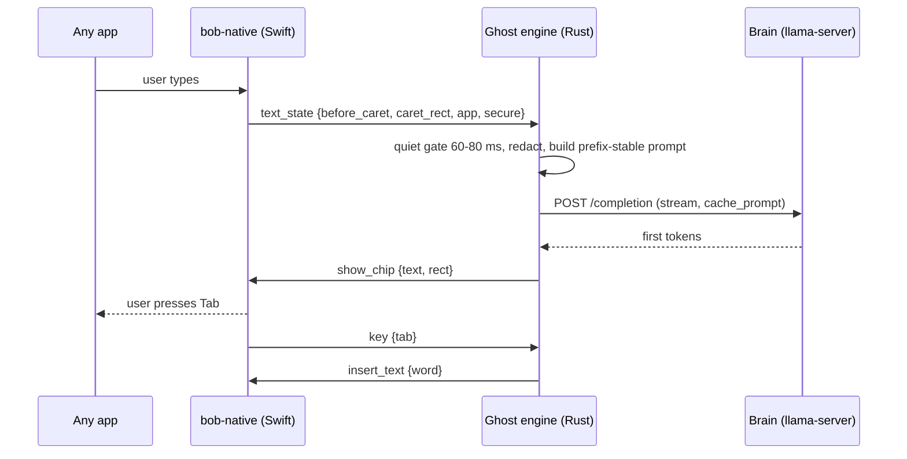

# Ghost Text: design

See `docs/ARCHITECTURE.md` for the system view. This document is refined as Tasks 4 to 6 land.

## Components
- **Swift helper:** AX observer (focus/value/selection), caret rect, native chip NSPanel, conditional CGEventTap,
  text insertion. Emits `text_state` events; receives `show_chip`, `update_chip`, `hide_chip`, `insert_text`.
- **Rust `ghost` module (pure core, no I/O):**
  - `prompt::build(text_before_caret, memory) -> Prompt` with a prefix-stable window.
  - `chip::polish(raw, typed_suffix) -> Option<Chip>` (word/char caps, filters).
  - `chip::type_through(chip, typed_char) -> TypeThrough { Advance(Chip) | Exhausted | Diverged }`.
  - `chip::accept_word(chip) -> (inserted, remainder)`.
  - `redact::scrub(&str) -> String`.
  - `memory::Lexicon` bounded most-recent-first store.
- **Rust `ghost::engine` (async):** debounce, cancellation, streaming from the active Brain, state machine
  `Idle -> Waiting -> Streaming -> Showing -> (Accepting | Dismissed)`.

## Sequence (happy path)

## Prefix-stable prompt window
Old text is dropped in coarse steps (paragraph start, else 256-character chunks aligned to a word boundary),
never a per-keystroke sliding window, so the llama.cpp KV cache prefix stays valid between requests.

## Correctness properties (property-based tests, `proptest`)
- **P1 (GT-7, GT-8):** for any chip and typed char, `type_through` returns `Advance` iff the char equals the chip's first char, and the advanced chip equals the original minus its first char.
- **P2 (GT-10):** `accept_word` yields `inserted + remainder == original` and `inserted` contains exactly one word (plus leading space).
- **P3 (GT-15):** `polish` never returns a chip over the word/char caps, never returns an empty or whitespace-only chip.
- **P4 (GT-16):** for any text `t` and appended text `s`, prompts for `t` and `t + s` share a prefix covering the window start when `len(t) + len(s)` stays inside the same window step.
- **P5 (GT-18):** `scrub(x)` never contains a credential-like token and is idempotent.
- **P6 (GT-17):** lexicon length never exceeds its cap, has no duplicates, and keeps the most recent entry first.

## Error handling
Brain unreachable or slow: hide chip, show a subtle orb error state, back off exponentially (cap 5 s).
Malformed AX data: treat as "no suggestion", never panic.

## Testing strategy
Unit + property tests for the pure core; mock-brain integration tests for the engine; Swift tests for the
protocol and chip geometry; manual compatibility matrix (`docs/COMPATIBILITY.md`); replay benchmark (Task 5).
