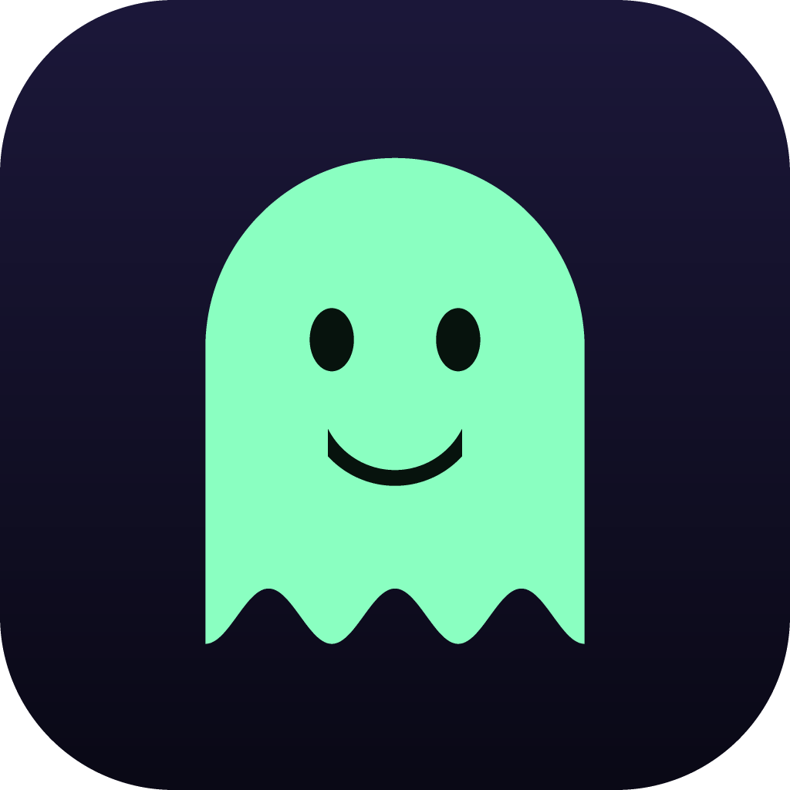

# BOB: Bring Your Own Brain

<p align="center"></p>

<p align="center"><em>A friendly ghost that haunts every app you type in, powered by any model you choose.</em></p>

BOB is a privacy-first macOS assistant. It adds three capabilities to every app, using a local model
(llama.cpp on Apple Silicon, Ollama, LM Studio) or any OpenAI-compatible cloud model:

| Capability | What it does | Status |
|---|---|---|
| **Ghost Text** | Inline next-word predictions at your caret. `Tab` accepts a word, `Shift+Tab` accepts all, `Esc` dismisses. Drops suggestions in languages you do not write. | Working (keystroke to chip p50 about 90 ms on M4 Max) |
| **Selection Actions** | Highlight text, press `⌘⇧J`, then fix / rephrase / shorten / summarize / translate or your own action, in place. Optional preview. | Working |
| **Voice Dictation** | Hold `⌥Space` (or tap to toggle), speak, and the text lands at the caret. Speak over a selection to edit it. Fully offline with whisper.cpp. | Working |
| **AI agents (MCP)** | Kiro and other agents can use BOB's brains and your writing style (off by default). See [docs/MCP.md](docs/MCP.md). | Working |

> Built for **Kiroween 2026** (category: Frankenstein) with [Kiro](https://kiro.dev). The `/.kiro` directory
> contains the specs, steering, hooks and custom agents used to build it. See [docs/KIRO.md](docs/KIRO.md).

## Status
All three capabilities work end to end, with per-app modes, preferred languages, statistics, an activity trail and
an MCP server. What is left (packaging a notarized release, the demo video) is in [docs/ROADMAP.md](docs/ROADMAP.md);
the submission checklist is [docs/SUBMISSION.md](docs/SUBMISSION.md).

## Requirements

- macOS 14+ on Apple Silicon (tested target: M3 with 16 GB or better)
- Node.js 20+, Rust 1.80+ (stable), Xcode command line tools with Swift 6

## Quickstart (from source)

```bash
git clone https://github.com/KoraiD/bob-assistant.git
cd bob-assistant
make setup        # installs JS dependencies
make dev          # runs the app (Tauri + Vite)
make test         # Rust, Swift and UI tests
make check        # everything CI runs
make bench        # Ghost Text benchmark with the real local model (see docs/PERFORMANCE.md)
```

`make help` lists all tasks.

### Local model (BOB's own brain)
```bash
make sidecars     # downloads the pinned llama.cpp server (SHA-256 verified) into src-tauri/binaries/llama
make dev          # then open Brains > "BOB's own brain" > Download, then Use
```
The default model is Qwen2.5-1.5B-Instruct (Q4_K_M, 1.1 GB, Apache-2.0). You can also add Ollama, LM Studio or any
OpenAI-compatible endpoint in the Brains tab. Models and binaries are never committed.

### Run BOB as a real app (needed for permissions)
`make dev` runs a bare binary from your terminal, so macOS attributes its permissions to the terminal app.
To give BOB its own Accessibility and Microphone permissions, build the signed bundle:
```bash
export BOB_SIGN_IDENTITY="Developer ID Application: <Name> (<TEAMID>)"   # optional; keeps grants across rebuilds
make app
open src-tauri/target/debug/bundle/macos/BOB.app
```
Then Overview > Grant permissions, and switch BOB on in System Settings > Privacy & Security.

### Permissions (added as features land)
BOB asks for **Accessibility** (read the caret, insert text) and **Microphone** (dictation). It asks for
**Screen Recording** only if you let it read the active window or all screens (Personalize tab). See
[docs/PRIVACY.md](docs/PRIVACY.md).

## Architecture in one picture

```
React/TS UI  <--IPC-->  Rust core (Tauri 2)  <--Unix socket-->  Swift helper (AX, event tap, overlays, mic)
                           |   brain router
                           +-- llama-server sidecar (local)   +-- Ollama / LM Studio / cloud (OpenAI-compatible)
                           +-- whisper sidecar (local)
```

Details: [docs/ARCHITECTURE.md](docs/ARCHITECTURE.md). Performance targets and measurements:
[docs/PERFORMANCE.md](docs/PERFORMANCE.md).

## Repository layout

See `.kiro/steering/structure.md`.

## License

[MIT](LICENSE). Third-party components and their licenses are listed in [THIRD_PARTY_NOTICES.md](THIRD_PARTY_NOTICES.md).
