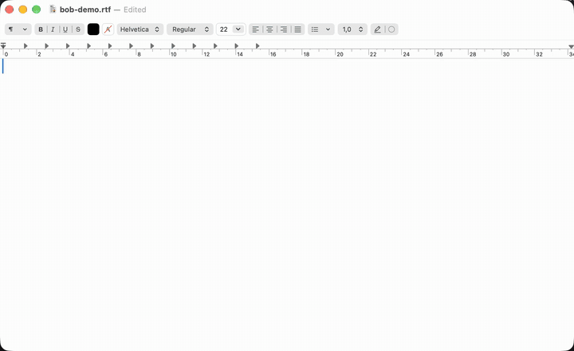
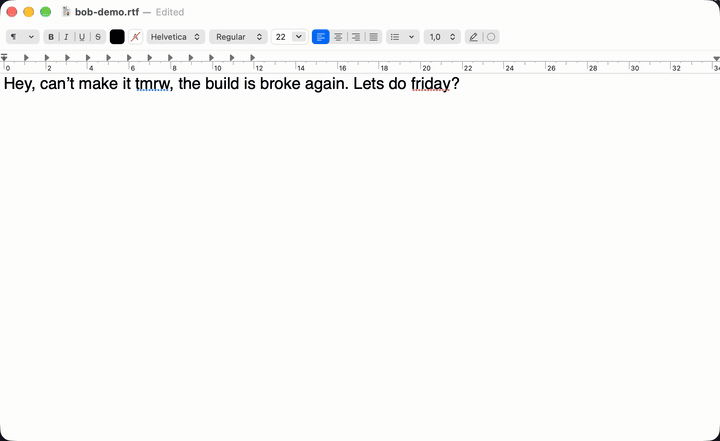

# BOB: Bring Your Own Brain

<p align="center"></p>
<p align="center"><em>A friendly ghost that helps you write in every Mac app, with the AI model you choose.</em></p>

BOB is a privacy-first writing assistant for macOS. It works in any app you type in and runs on a model on your
Mac by default (llama.cpp and whisper.cpp). You can also connect Ollama, LM Studio or any OpenAI-compatible service.

| Feature | What it does |
|---|---|
| **Ghost Text** | Suggests the next words at your cursor. `Tab` takes a word, `⇧Tab` takes the rest, `Esc` dismisses. Fixes typos, fills gaps inside a sentence, and stays out of the way of an app's own lists (Slack `@mentions`). |
| **Selection Actions** | Select text, press `⌘⇧J`, and fix, rephrase, shorten, summarize, translate or run your own action (with its own shortcut if you like). The result replaces the selection; `⌘Z` undoes it. Explain and Reply show an answer to copy or insert instead. |
| **Voice Dictation** | Hold `⌥Space` (or tap it), speak, and the text appears at the cursor. Speak over a selection to edit it. Recognized on your Mac. |
| **AI agents (MCP)** | Kiro and other MCP clients can use BOB's models and your writing style. Off by default. See [docs/MCP.md](docs/MCP.md). |

## See it

**Ghost Text:** pause while typing and the next words appear at the cursor. `Tab` takes a word, `⇧Tab` the rest.

<p align="center"></p>

**Selection Actions:** select a rough sentence, press `⌘⇧J` and choose an action.

<p align="center"></p>

Both run on BOB's own model on the Mac, recorded on the build machine with `scripts/record-gifs.sh`.

Built for **Kiroween 2026** (category: Frankenstein) with [Kiro](https://kiro.dev). The `.kiro` folder holds the
specs, steering, hooks and agents used to build it; [docs/KIRO.md](docs/KIRO.md) explains how.

## Install

Requirements: macOS 14 or later on Apple Silicon. 16 GB of memory is recommended for the default models.

1. Download `BOB-<version>-arm64.dmg` from [Releases](https://github.com/KoraiD/bob-assistant/releases) and check
   its SHA-256 against the `.sha256` file.
2. Drag BOB to Applications and open it.
   The current release is signed with a Developer ID but not notarized yet. If macOS blocks it, open
   **System Settings > Privacy & Security** and click **Open Anyway** next to the BOB message.
3. The welcome tour asks for **Accessibility** and **Microphone** access and downloads the models it recommends
   for your Mac (about 1.1 GB for writing and 0.6 GB for speech).

## Privacy in short

- No accounts, no telemetry. Your text goes only to the model you choose; cloud models are labeled.
- BOB reads the text around your cursor through Accessibility. Reading the screen is opt-in and recognized on
  your Mac; images are never saved or sent.
- Audio stays in memory and is transcribed on your Mac. API keys live in the macOS Keychain.
- Logs and the activity list (Settings) contain sizes and timings, never your text.

Details: [docs/PRIVACY.md](docs/PRIVACY.md) and [docs/SECURITY.md](docs/SECURITY.md).

## Build from source

You need Node.js 20+, Rust 1.89+ and the Xcode command line tools (Swift 6).

```bash
git clone https://github.com/KoraiD/bob-assistant.git && cd bob-assistant
make setup        # JavaScript dependencies
make sidecars     # llama.cpp server, pinned and SHA-256 verified
make whisper      # whisper.cpp framework, pinned and SHA-256 verified
make app          # signed BOB.app in src-tauri/target/debug/bundle/macos
make check        # everything CI runs: formatting, lints and all tests
```

`make app` signs with `BOB_SIGN_IDENTITY` when it is set, so macOS keeps your permission grants between builds.
`make release` builds the DMG ([docs/RELEASE.md](docs/RELEASE.md)). `make help` lists every task.

## How it fits together

```
React UI  ── Tauri IPC ──  Rust core  ── Unix socket ──  Swift helper (Accessibility, keys, overlays, microphone, whisper.cpp)
                              │
                              ├── llama.cpp server on this Mac (127.0.0.1, per-launch key)
                              ├── Ollama, LM Studio or a cloud API
                              └── MCP control socket (only while AI agents are allowed)
```

More: [ARCHITECTURE](docs/ARCHITECTURE.md) · [PERFORMANCE](docs/PERFORMANCE.md) ·
[COMPATIBILITY](docs/COMPATIBILITY.md) · [DESIGN](docs/DESIGN.md) · [ROADMAP](docs/ROADMAP.md) ·
[CHANGELOG](CHANGELOG.md)

## License

[MIT](LICENSE). Third-party components and model licenses: [THIRD_PARTY_NOTICES.md](THIRD_PARTY_NOTICES.md).
