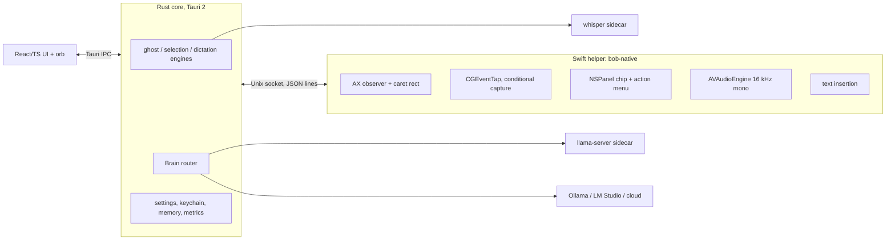

# Architecture

Status: Task 3 (Brain layer). Sections marked *planned* describe the target design from the specs.

## Overview

## Why this shape
- **Swift helper for macOS integration:** Accessibility, event taps and panels have first-class Swift APIs.
  The helper is a separate process so a crash cannot take down the core and so it can be restarted.
- **Rust core:** one place for scheduling, cancellation, brains and settings; pure logic is property-tested.
- **Sidecars, not in-process FFI:** model servers are replaceable and isolated; llama.cpp's server already
  provides prompt-prefix caching, slots and streaming.
- **Native chip rendering:** the Ghost Text hot path (keystroke -> chip) never crosses the webview.

## Components (current)
| Component | Location | State |
|---|---|---|
| App shell, tray, hide-on-close | `src-tauri/src/lib.rs` | done |
| App metadata IPC | `src-tauri/src/app_info.rs` | done, unit + property tests |
| Haunted UI shell | `src/` | done (tokens, ghost mark, capability cards) |
| Wire protocol (Rust) | `src-tauri/src/protocol.rs` | done: tagged JSON lines, chunk-safe decoder, version check; unit + property tests |
| Socket bridge | `src-tauri/src/native_ipc.rs` | done: 0700 dir / 0600 socket, handshake, status, send; tests over socket pairs |
| Helper supervisor | `src-tauri/src/supervisor.rs` | done: spawn, exponential backoff restart, stop on exit |
| Swift protocol + decoder | `native/bob-native/Sources/BobNativeCore/{Protocol,LineDecoder}.swift` | done; shares fixtures with Rust |
| Accessibility reader + observer | `AXReader.swift`, `FocusObserver.swift` | done; validated by the manual matrix |
| Caret geometry, text window | `Geometry.swift` | done: unit tests |
| Native chip panel | `ChipPanel.swift` | done (demo); wired to the Ghost engine in Task 4 |
| Permissions card + tray status | `src/components/PermissionsCard.tsx`, `src-tauri/src/lib.rs` | done |
| Brain types, capabilities, cloud labeling | `src-tauri/src/brain/mod.rs` | done; property test for loopback vs cloud |
| SSE decoder | `brain/sse.rs` | done; chunking-independence property test |
| Dialects (llama.cpp `/completion`, OpenAI `/v1/*`) | `brain/dialect.rs` | done |
| HTTP brain client (stream, cancel, connection test) | `brain/client.rs` | done; tests against an in-process HTTP server, incl. disconnect detection |
| Registry and roles (`brains.json`) | `brain/registry.rs` | done; invariant property test over random operation sequences |
| Keychain secrets | `brain/secrets.rs` | done (`keyring`, apple-native) |
| Model catalog and verified downloads | `brain/models.rs` | done; resume, SHA-256, property test "only verified content is installed" |
| llama-server sidecar | `brain/sidecar.rs` | done; fake-server tests for start, auth, stop, crash restart; ignored real-model test |
| Brain service + IPC commands | `brain/service.rs`, `commands.rs` | done |
| Brain panel | `src/components/BrainPanel.tsx`, `src/lib/brains.ts` | done |
| Ghost engine | `src-tauri/src/ghost/*` | planned (Tasks 4 to 6) |

## Decisions log
| Date | Decision | Reason |
|---|---|---|
| 2026-11-22 | Makefile instead of `just` | one fewer tool for judges to install |
| 2026-11-22 | Tailwind v4 + Vite 6 + Vitest 3 | Vitest 2 nested its own Vite and broke config typing; Vitest 3 shares the root Vite |
| 2026-11-22 | `$schema` omitted in Tauri JSON | optional key; keeps files local-only and tool-friendly |
| 2026-11-22 | Swift language mode 5 for the helper | AX C callbacks and AppKit main-thread conventions do not fit Swift 6 strict concurrency without pervasive unsafe annotations; pure logic stays Sendable-clean |
| 2026-11-22 | std threads for the bridge, no async runtime yet | the bridge is a few blocking sockets; tokio arrives with the Brain router (Task 3) |
| 2026-11-22 | `serde_json` `float_roundtrip` | a property test showed default float parsing is off by 1 ULP for ~18% of coordinate-range values (measured on 2M samples); the feature makes the protocol exactly reproducible. Impact on a caret position was far below a pixel, but exact round trips keep tests deterministic. Docs: https://docs.rs/crate/serde_json/latest/features |
| 2026-11-22 | `String(bytes:encoding:)` instead of `String(validating:as:)` in Swift | the latter needs macOS 15; the deployment target is macOS 14 |
| 2026-11-22 | Mic permission is requested only when an `NSMicrophoneUsageDescription` exists | macOS terminates a process that requests the microphone without one; a bare `swift run` helper has none, the packaged app will |

| 2026-11-22 | reqwest 0.13 (`rustls`), crate `rust-version` 1.85 | latest reqwest needs Rust 1.85; the 0.12 `rustls-tls` feature was renamed `rustls` |
| 2026-11-22 | Built-in brain = pinned prebuilt `llama-server` (b12633, SHA-256 verified) as a separate process | no FFI or patched crates; the prebuilt links its ggml/llama dylibs via `@rpath`, so the whole directory is kept together (`make sidecars`, bundled as a resource folder in Task 10) |
| 2026-11-22 | `--api-key-file`, never `--api-key` | a key in argv is visible to every local user via `ps`; checked in a unit test and on the running process |
| 2026-11-22 | One model for Ghost and Selection by default (Qwen2.5-1.5B-Instruct Q4_K_M, Apache-2.0) | one resident server fits 16 GB Macs; base-model GGUFs exist only as low-download community conversions. Task 5 benchmarks the Qwen3-1.7B-Base candidate |
| 2026-11-22 | Qwen2.5-3B rejected | its license is not Apache-2.0 ("other" on the model card); every catalog entry must be Apache-2.0 (unit test) |
| 2026-11-22 | PID file + startup cleanup, SIGTERM/SIGINT routed to `app.exit` | a crashed or killed BOB would otherwise leave llama-server holding ~1 GB; verified by killing the app |
| 2026-11-22 | `env_logger` to stderr, metadata only | without a logger `log::warn!` was silently dropped, which hid a startup bug |

## Brain layer
`BrainConfig` (provider kind, endpoint, optional model, capability flags) is persisted in `brains.json` (no secrets).
Roles route features to brains: Ghost Text needs the `ghost` capability (raw completion endpoint), Selection
Actions and Dictation cleanup need `chat`. The registry refuses incapable assignments and clears roles when a
brain is removed or loses a capability. A connection test proves capabilities with one-token requests and saves
what it proved. The built-in brain resolves to the running sidecar's loopback endpoint and per-launch key.

## Native bridge protocol (v1)
Newline-delimited JSON over `$TMPDIR/bob-<uid>/native.sock`. Helper to core: `hello`, `permissions`, `focus`, `text_state`,
`error`. Core to helper: `hello_ack`, `reject`, `show_chip`, `hide_chip`, `request_permissions`, `quit`. Unknown `type` values are
ignored on both sides. Shared fixtures: `native/bob-native/Tests/Fixtures/*.jsonl` (decoded and re-encoded by both test suites).
Typed text only travels in `text_state.before_caret`, is capped to the last 2000 characters, and is never logged.

## Dependencies
Rust: tauri 2, serde, serde_json (float_roundtrip), log, env_logger, tokio, reqwest 0.13 (rustls), futures-util, bytes,
thiserror, sha2, hex, rand, url, keyring (apple-native); dev: proptest. JS: react 18, vite 6, tailwind 4, vitest 3,
@tauri-apps/api. Swift: standard library and Swift Testing only (no third-party packages).
