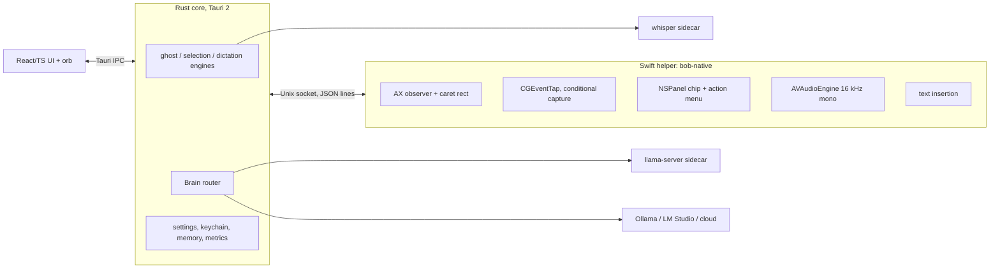

# Architecture

Status: Task 1 (shell). Sections marked *planned* describe the target design from the specs.

## Overview

## Why this shape
- **Swift helper for macOS integration:** Accessibility, event taps and panels have first-class Swift APIs.
  The helper is a separate process so a crash cannot take down the core and so it can be restarted.
- **Rust core:** one place for scheduling, cancellation, brains and settings; pure logic is property-tested.
- **Sidecars, not in-process FFI:** model servers are replaceable and isolated; llama.cpp's server already
  provides prompt-prefix caching, slots and streaming.
- **Native chip rendering:** the Ghost Text hot path (keystroke -> chip) never crosses the webview.

## Components (current)
| Component | Location | State |
|---|---|---|
| App shell, tray, hide-on-close | `src-tauri/src/lib.rs` | done |
| App metadata IPC | `src-tauri/src/app_info.rs` | done, unit + property tests |
| Haunted UI shell | `src/` | done (tokens, ghost mark, capability cards) |
| Swift helper skeleton | `native/bob-native` | done (package, tests); IPC in Task 2 |
| Brain router, sidecars | `src-tauri/src/brain/*` | planned (Task 3) |
| Ghost engine | `src-tauri/src/ghost/*` | planned (Tasks 4 to 6) |

## Decisions log
| Date | Decision | Reason |
|---|---|---|
| 2026-11-22 | Makefile instead of `just` | one fewer tool for judges to install |
| 2026-11-22 | Tailwind v4 + Vite 6 + Vitest 3 | Vitest 2 nested its own Vite and broke config typing; Vitest 3 shares the root Vite |
| 2026-11-22 | `$schema` omitted in Tauri JSON | optional key; keeps files local-only and tool-friendly |

## Dependencies
Rust: tauri 2, serde, serde_json, log; dev: proptest. JS: react 18, vite 6, tailwind 4, vitest 3,
@tauri-apps/api. Swift: standard library and Swift Testing only (no third-party packages).
