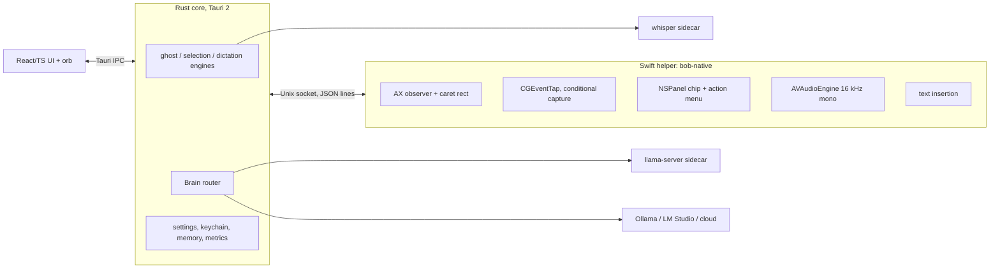
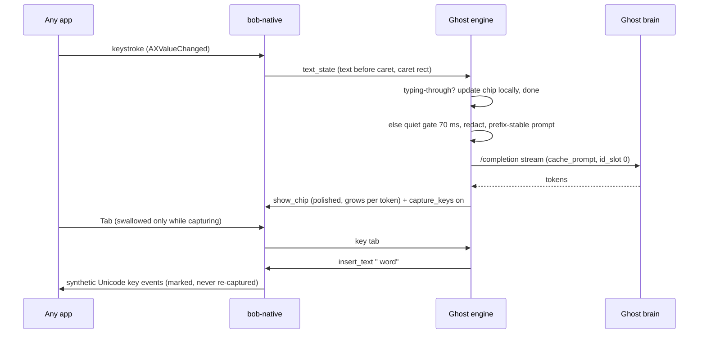

# Architecture

Status: Task 4 (Ghost Text engine). Sections marked *planned* describe the target design from the specs.

## Overview

## Why this shape
- **Swift helper for macOS integration:** Accessibility, event taps and panels have first-class Swift APIs.
  The helper is a separate process so a crash cannot take down the core and so it can be restarted.
- **Rust core:** one place for scheduling, cancellation, brains and settings; pure logic is property-tested.
- **Sidecars, not in-process FFI:** model servers are replaceable and isolated; llama.cpp's server already
  provides prompt-prefix caching, slots and streaming.
- **Native chip rendering:** the Ghost Text hot path (keystroke -> chip) never crosses the webview.

## Components (current)
| Component | Location | State |
|---|---|---|
| App shell, tray, hide-on-close | `src-tauri/src/lib.rs` | done |
| App metadata IPC | `src-tauri/src/app_info.rs` | done, unit + property tests |
| Haunted UI shell | `src/` | done (tokens, ghost mark, capability cards) |
| Wire protocol (Rust) | `src-tauri/src/protocol.rs` | done: tagged JSON lines, chunk-safe decoder, version check; unit + property tests |
| Socket bridge | `src-tauri/src/native_ipc.rs` | done: 0700 dir / 0600 socket, handshake, status, send; tests over socket pairs |
| Helper supervisor | `src-tauri/src/supervisor.rs` | done: spawn, exponential backoff restart, stop on exit |
| Swift protocol + decoder | `native/bob-native/Sources/BobNativeCore/{Protocol,LineDecoder}.swift` | done; shares fixtures with Rust |
| Accessibility reader + observer | `AXReader.swift`, `FocusObserver.swift` | done; validated by the manual matrix |
| Caret geometry, text window | `Geometry.swift` | done: unit tests |
| Native chip panel | `ChipPanel.swift` | done (demo); wired to the Ghost engine in Task 4 |
| Permissions card + tray status | `src/components/PermissionsCard.tsx`, `src-tauri/src/lib.rs` | done |
| Brain types, capabilities, cloud labeling | `src-tauri/src/brain/mod.rs` | done; property test for loopback vs cloud |
| SSE decoder | `brain/sse.rs` | done; chunking-independence property test |
| Dialects (llama.cpp `/completion`, OpenAI `/v1/*`) | `brain/dialect.rs` | done |
| HTTP brain client (stream, cancel, connection test) | `brain/client.rs` | done; tests against an in-process HTTP server, incl. disconnect detection |
| Registry and roles (`brains.json`) | `brain/registry.rs` | done; invariant property test over random operation sequences |
| Keychain secrets | `brain/secrets.rs` | done (`keyring`, apple-native) |
| Model catalog and verified downloads | `brain/models.rs` | done; resume, SHA-256, property test "only verified content is installed" |
| llama-server sidecar | `brain/sidecar.rs` | done; fake-server tests for start, auth, stop, crash restart; ignored real-model test |
| Brain service + IPC commands | `brain/service.rs`, `commands.rs` | done |
| Brain panel | `src/components/BrainPanel.tsx`, `src/lib/brains.ts` | done |
| Ghost core: redaction, prompt window, chip polish, typing-through, accept-word | `src-tauri/src/ghost/{redact,prompt,chip}.rs` | done; property tests P1 to P5 |
| Ghost engine (debounce, cancel, stream, keys, quiet zones, quiet apps, recent apps, stats) | `src-tauri/src/ghost/engine.rs` | done; 16 tests against the real Brain service + test server; ignored real-model pipeline test |
| Ghost settings (on/off, quiet apps) and accepted-phrase memory, persisted in the app config dir | `src-tauri/src/ghost/{settings,memory}.rs` | done; property tests for both (memory is P6) |
| Key tap (conditional Tab / Shift+Tab / Esc) and Unicode insertion | `native/bob-native/Sources/BobNativeCore/{KeyTap,TextInserter}.swift` | done; decision logic and chunking tested |
| Ghost card (on/off, p50/p95, quiet-app switches, remembered phrases with Forget all) | `src/components/GhostCard.tsx` | done |
| Personal context: settings, `profile.md`, visible state, prompt assembly (spec `personal-context`) | `src-tauri/src/context/` | done; unit + property tests (budget, redaction, scope) |
| Window title, after-caret text, opt-in screen text (ScreenCaptureKit + Vision OCR) | `AXReader.swift`, `ScreenContext.swift` | done; capture policy and line layout tested |
| Personalize tab (profile editor, scope, style, Ghost layers, preview), per-brain sharing switch | `src/components/PersonalizePanel.tsx`, `BrainPanel.tsx` | done |
| Selection Actions engine, actions, output cleaner (spec `selection-actions`) | `src-tauri/src/selection/` | done; engine tests against a chat test server, cleaner property test P5 |
| Hotkey, selection read/replace, clipboard snapshot, action menu | `HotkeyCenter.swift`, `SelectionIO.swift`, `ActionMenuPanel.swift` | done; P1 to P3 tested; undo per app is a manual check |
| Selection card (hotkey, actions, custom actions, stats) | `src/components/SelectionCard.tsx` | done |
| Cmd+Q key monitor | `src-tauri/src/quit_key.rs` | done |
| Dictation state machine (P1, P2), settings, engine with cleanup presets | `src-tauri/src/dictation/` | done; property tests and engine tests |
| Hold-to-talk hotkey, microphone capture (16 kHz mono, memory only), speech gate, whisper transcriber, orb | `HotkeyCenter.swift`, `AudioRecorder.swift`, `Transcriber.swift`, `OrbPanel.swift` | done; speech gate, layout and a golden `say` transcription tested |
| Dictation card (on/off, hotkey, language, cleanup, speech models, timings, vocabulary, replacements, tap-to-toggle, idle unload, last dictation) | `src/components/DictationCard.tsx` | done |
| Voice edit: speech over a selection becomes an instruction for the Selection brain | `HelperRuntime.swift` (`dictation_selection`), `dictation/engine.rs`, `selection/engine.rs` (`voice_edit`) | done; engine tests |
| Writing style: quote style for everything BOB types, US/UK spelling for brains | `src-tauri/src/context/typography.rs` | done; property test (only quotes change, idempotent) |
| Usage statistics (counts only) and the Statistics panel | `src-tauri/src/usage.rs`, `src/components/StatsPanel.tsx` | done |
| This Mac: chip and RAM for the model recommendation, running apps for the quiet-apps picker | `src-tauri/src/system.rs` | done |
| Open at login: SMAppService, LaunchAgent fallback | `src-tauri/src/app_settings.rs` | done; plist test, ignored real round trip |
| Preferred languages: chip filter, detection, language check of rewrites | `src-tauri/src/context/languages.rs` | done; property test (filter only shortens) |
| Per-app modes, style notes, clipboard and language-hint layers | `src-tauri/src/context/mod.rs` | done |
| MCP server (`bob-mcp`) and control socket | `src-tauri/src/mcp.rs`, `src/bin/bob-mcp.rs` | done; JSON-RPC and real-socket tests |
| Logging (levels, rotating file, tail) and audit trail | `src-tauri/src/logging.rs`, `audit.rs` | done |
| Private, durable file writes | `src-tauri/src/fsutil.rs` | done |
| Clipboard watcher, dictation sounds, settle re-reads | `ClipboardWatcher.swift`, `DictationSounds.swift`, `FocusObserver.swift` | done; Swift tests |
| Ghost Text settings matrix and randomized sessions | `src-tauri/src/ghost/matrix_tests.rs` | done |
| Mac-style controls (groups, rows, switches, segmented, icons) | `src/components/ui.tsx` | done |
| Typo fixes (macOS spell checker) and keyboard-layout lookup | `TypoFinder.swift`, `KeyLayout.swift` | done; Swift tests |
| Gap prompt for suggestions inside a sentence | `ghost/prompt.rs` (`gap`), `ghost/chip.rs` (`gap_chip`) | done; unit and engine tests |
| Release build (bundled model server, signing, DMG) | `scripts/build-release.sh` | done, verified (RELEASE.md) |
| Simulator (test only): the real Ghost Text, Selection Actions and Dictation engines against a fake app, helper, models and user on a virtual clock; app profiles for TextEdit (plain and smart quotes), Electron and Chrome; seeded sessions replay exactly; test builds capture every log line in memory | `src-tauri/src/sim/` (`cargo test sim::`; soak: `cargo test sim::random::soak -- --ignored --nocapture`) | 14 regression tests for confirmed bugs (ignored until fixed); random sessions on every CI run for Ghost Text (48), Ghost setting combinations (64), Selection Actions (24) and Dictation (16), plus fuzzing of the MCP control server and the native bridge; checks cover wrong or unrequested text, password fields, credentials to cloud brains and text in the log |
| End-to-end check in TextEdit | `scripts/e2e.swift` (`make e2e`) | 14 of 14 pass (Ghost Text, typo fix, gap, window switch, Fix grammar, undo, Explain) |
| Quiet-apps and phrases editors, interactive ghost | `src/components/{GhostLists,GhostMark}.tsx` | done |
| File locations and the separate profile (`BOB_HOME`) | `src-tauri/src/paths.rs` | done; unit tests, checked next to an installed BOB |
| Test Bench (`BOB Test Bench.app`, with its own Accessibility switch): a typist types like a person into the bench's own editor while a test BOB (separate profile) suggests; every step is checked (text, Tab and Shift+Tab, chip following the text, Esc). Editor profiles: plain, smart quotes, and late (Accessibility reports the text 60 to 250 ms behind, like Chrome and Electron apps). It holds your BOB's instance lock, types only while its editor has focus, pauses while the mouse is used or another window is in front, and stops on any key press. It reads and writes only in `/tmp`. A fake OpenAI-compatible brain continues corpus sentences | `native/test-bench/`, `scripts/test-bench.sh`, `scripts/fake-brain.py` (`make test-bench`) | done; logic tests in CI (a correct fake BOB gives no findings, injected bugs are found) |
| Test audio file for dictation and the main-thread stall switch (helper built with `-DBOB_TEST_HOOKS` only) | `TestHooks.swift`, `AudioRecorder(testAudioFile:)` | done; Swift tests; neither variable name is in the release helper |

## Decisions log
| Date | Decision | Reason |
|---|---|---|
| 2026-11-22 | Makefile instead of `just` | one fewer tool for judges to install |
| 2026-11-22 | Tailwind v4 + Vite 6 + Vitest 3 | Vitest 2 nested its own Vite and broke config typing; Vitest 3 shares the root Vite |
| 2026-11-22 | `$schema` omitted in Tauri JSON | optional key; keeps files local-only and tool-friendly |
| 2026-11-22 | Swift language mode 5 for the helper | AX C callbacks and AppKit main-thread conventions do not fit Swift 6 strict concurrency without pervasive unsafe annotations; pure logic stays Sendable-clean |
| 2026-11-22 | std threads for the bridge, no async runtime yet | the bridge is a few blocking sockets; tokio arrives with the Brain router (Task 3) |
| 2026-11-22 | `serde_json` `float_roundtrip` | a property test showed default float parsing is off by 1 ULP for ~18% of coordinate-range values (measured on 2M samples); the feature makes the protocol exactly reproducible. Impact on a caret position was far below a pixel, but exact round trips keep tests deterministic. Docs: https://docs.rs/crate/serde_json/latest/features |
| 2026-11-22 | `String(bytes:encoding:)` instead of `String(validating:as:)` in Swift | the latter needs macOS 15; the deployment target is macOS 14 |
| 2026-11-22 | Mic permission is requested only when an `NSMicrophoneUsageDescription` exists | macOS terminates a process that requests the microphone without one; a bare `swift run` helper has none, the packaged app will |

| 2026-11-22 | reqwest 0.13 (`rustls`), crate `rust-version` 1.85 | latest reqwest needs Rust 1.85; the 0.12 `rustls-tls` feature was renamed `rustls` |
| 2026-11-22 | Built-in brain = pinned prebuilt `llama-server` (b12633, SHA-256 verified) as a separate process | no FFI or patched crates; the prebuilt links its ggml/llama dylibs via `@rpath`, so the whole directory is kept together (`make sidecars`, bundled as a resource folder in Task 10) |
| 2026-11-22 | `--api-key-file`, never `--api-key` | a key in argv is visible to every local user via `ps`; checked in a unit test and on the running process |
| 2026-11-22 | One model for Ghost and Selection by default (Qwen2.5-1.5B-Instruct Q4_K_M, Apache-2.0) | one resident server fits 16 GB Macs; base-model GGUFs exist only as low-download community conversions. Task 5 benchmarks the Qwen3-1.7B-Base candidate |
| 2026-11-22 | Qwen2.5-3B rejected | its license is not Apache-2.0 ("other" on the model card); every catalog entry must be Apache-2.0 (unit test) |
| 2026-11-22 | PID file + startup cleanup, SIGTERM/SIGINT routed to `app.exit` | a crashed or killed BOB would otherwise leave llama-server holding ~1 GB; verified by killing the app |
| 2026-11-22 | `env_logger` to stderr, metadata only | without a logger `log::warn!` was silently dropped, which hid a startup bug |
| 2026-11-23 | Dictation = whisper.cpp's official xcframework (b5907) linked into the Swift helper | answers spike question 2. whisper.cpp ships no macOS server binary. In-helper inference keeps audio inside the process that records it (VD-8), needs no unauthenticated local HTTP server (`whisper-server` has no auth and a `/load` endpoint), and uses the upstream Metal build pinned by SHA-256. Alternatives: building `whisper-server` in CI, or `whisper-rs` in the Rust core (a crash would take down the app) |
| 2026-11-23 | Default speech model large-v3-turbo Q5_0; base as the light option | measured on fixtures (PERFORMANCE.md): turbo was exact in English and Hungarian at 258 to 308 ms warm; base is 20 to 80 ms but mangles Hungarian |
| 2026-11-23 | Full 30 s encoder window (`audio_ctx` = 0) | a shortened window was 2 to 5 times faster but added a word error in English and a hallucinated repeat in Hungarian |
| 2026-11-23 | Free the whisper model before every helper exit | ggml's Metal backend asserts in a static destructor when model buffers are alive at `exit`, so every quit produced a crash report; reproduced and verified fixed |
| 2026-11-24 | Voice edit as a separate `dictation_selection` event, read with Accessibility at recording start | adding a field to `transcript` would mix two concerns; the clipboard fallback is not used while a key is held (Cmd+C would collide with the held modifier) |
| 2026-11-24 | Vocabulary as whisper's `initial_prompt` ("Glossary: a, b.") | whisper.cpp's supported biasing mechanism; bounded to 600 characters so it never crowds the context |
| 2026-11-24 | Tap-to-toggle in the pure machine (`Latched` state) | the 250 ms "tap" that used to be discarded now latches recording; P1 still holds with the toggle on and off |
| 2026-11-24 | Idle unload sends `set_dictation` with no model; the next press reloads | the helper's whisper queue is serial, so a recording made during the reload is transcribed after it, with no new protocol |
| 2026-11-24 | Open at login falls back to a LaunchAgent plist (`/usr/bin/open` the bundle) | `SMAppService.mainApp` reports "not found" for this development build (logged at startup); the plist works for any build and is removed when the switch is turned off |
| 2026-11-25 | Suggestions inside a sentence use a worked-example gap prompt | the default model ignores fill-in-the-middle tokens (measured); two examples were enough |
| 2026-11-25 | Rewrites paste instead of writing the selection through Accessibility | pastes are undoable in one step in every app; the Accessibility write was not undoable in TextEdit |
| 2026-11-25 | Background first and the task last in chat prompts | screen text placed last leaked into rewrites in the end-to-end run |
| 2026-11-24 | MCP as a separate stdio binary that talks to the app over a same-user socket, off by default | agents launch MCP servers as child processes; the running app owns the engines and models, so `bob-mcp` stays a thin forwarder and nothing listens unless the user allows it |
| 2026-11-24 | Own logger instead of `env_logger` | one place for levels that change at runtime, a rotating 0600 file, an in-app tail and redaction of every line |
| 2026-11-24 | Language filter from letters plus common words, no language-ID model | catches the measured drifts (Vietnamese, French) in microseconds; a model would cost memory and latency on the Ghost Text hot path |
| 2026-11-24 | Re-read the focused field after each change in the helper | Chrome updates the caret before the text; three cheap re-reads fix the stale chip at its source |
| 2026-11-24 | Usage is a process-wide recorder saved at most every 30 s and at exit | engines count without new plumbing; counts only, never text |
| 2026-11-26 | A separate profile through `BOB_HOME`, models shared | the Test Bench needs a second BOB that cannot touch the user's settings, memory, logs, keys or sockets; sharing models avoids a second 1 GB download. A bad value stops BOB (exit 2) instead of falling back to the real folders |
| 2026-11-27 | Models are hashed once per launch before loading, remembered in memory only (code review SEC-13) | any same-user process can replace a model file, which llama-server and whisper then parse. A stamp file could be forged, so the result is kept in memory and tied to the file's identity including ctime. Costs 0.45 s before the first launch's model server starts (docs/PERFORMANCE.md); sha2 moved to 0.11 for the Arm SHA-256 instructions |
| 2026-11-27 | Development overrides only in debug builds; release builds reset `HOME`, `TMPDIR` and `PATH` at launch (code review SEC-12) | any same-user process could start a release BOB with `open --env BOB_NATIVE_PATH=...` and have its own program run with BOB's Accessibility and Microphone permissions. Checking the signatures of the bundled programs was left out: macOS already protects a notarized bundle from other apps |
| 2026-11-26 | The Test Bench types into its own editor only, through the HID event stream | BOB's key tap only sees events at the HID or session level, so `postToPid` would skip BOB; the bench owns the window it types into, checks focus before every key and watches for other input, and reads BOB's chip label through Accessibility |
| 2026-11-26 | Test hooks behind a compile flag, not `#if DEBUG` | `build-app.sh` builds the helper with `-c release` even for dev builds, so `DEBUG` would not include them; a flag keeps them out of every shipped build |
| 2026-11-23 | Dictation state machine in Rust, audio in Swift | the core owns timing rules (250 ms minimum hold, 5-minute cap) as a pure, property-tested machine; the helper only records, gates silence and transcribes |

## Ghost Text pipeline

## Brain layer
`BrainConfig` (provider kind, endpoint, optional model, capability flags) is persisted in `brains.json` (no secrets).
Roles route features to brains: Ghost Text needs the `ghost` capability (raw completion endpoint), Selection
Actions and Dictation cleanup need `chat`. The registry refuses incapable assignments and clears roles when a
brain is removed or loses a capability. A connection test proves capabilities with one-token requests and saves
what it proved. The built-in brain resolves to the running sidecar's loopback endpoint and per-launch key.

## File locations
| What | Normal | Separate profile (`BOB_HOME=/tmp/bob-test`) |
|---|---|---|
| Settings, memory, profile notes, usage | `~/Library/Application Support/dev.bob.assistant` | `$BOB_HOME/config` |
| Models | `~/Library/Application Support/dev.bob.assistant/models` | shared with the normal profile |
| Logs and activity trail | `~/Library/Logs/BOB` | `$BOB_HOME/logs` |
| Sockets, instance lock, model server key and PID | `$TMPDIR/bob-<uid>` | `$BOB_HOME/run` |
| API keys | Keychain service `dev.bob.assistant` | Keychain service `dev.bob.assistant.separate-profile` |

Every folder is 0700. `BOB_HOME` must be absolute, without `.` or `..`, not `/` or the home folder, and short
enough for `run/control.sock` to fit a socket path (103 bytes). A separate profile does not save the window position
and cannot change the login item, and its tray tooltip and window title end in "(separate profile)". The web view's
storage (theme, welcome tour seen) is still shared, because WebKit keeps it per app bundle. `bob-mcp` follows
`BOB_HOME` too, so an agent reaches the matching BOB.

`BOB_HOME` and the other development overrides (`BOB_NATIVE_PATH`, `BOB_LLAMA_SERVER`, `BOB_CONTROL_SOCKET`) work in
debug builds only (`make app`, which the Test Bench uses). Release builds remove them at launch and take `HOME`,
`TMPDIR` and `PATH` from the system (`getpwuid_r`, `confstr(_CS_DARWIN_USER_TEMP_DIR)`, `/usr/bin:/bin:/usr/sbin:/sbin`),
so `$TMPDIR` in the table above means the system's per-user temporary folder; `bob-mcp` does the same.

## Native bridge protocol (v1)
Version 2. Newline-delimited JSON over `native.sock` in the runtime folder (File locations). Helper to core: `hello`, `permissions`, `focus`,
`text_state`, `error`, `key`, `insert_refused` (with `reason`: `secure_input`, `secure_field` or `unreadable`). Core to helper: `hello_ack`, `reject`, `show_chip`, `hide_chip`, `insert_text`, `capture_keys`,
`request_permissions`, `quit`. Unknown `type` values are
ignored on both sides. Shared fixtures: `native/bob-native/Tests/Fixtures/*.jsonl` (decoded and re-encoded by both test suites).
Typed text only travels in `text_state.before_caret`, is capped to the last 2000 characters, and is never logged.

## Dependencies
Rust: tauri 2, serde, serde_json (float_roundtrip), log, env_logger, tokio, reqwest 0.13 (rustls), futures-util, bytes,
thiserror, sha2 0.11 (optimized in debug builds too), hex, rand, url, keyring (apple-native), libc (system home and temp folders; it was already in the
build through other crates); dev: proptest. JS: react 18, vite 6, tailwind 4, vitest 3,
@tauri-apps/api. Swift: standard library and Swift Testing only (no third-party packages).
