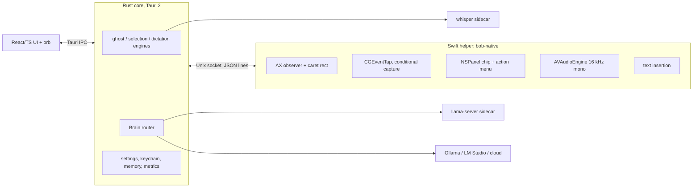

# Architecture

Status: Task 2 (native bridge). Sections marked *planned* describe the target design from the specs.

## Overview

## Why this shape
- **Swift helper for macOS integration:** Accessibility, event taps and panels have first-class Swift APIs.
  The helper is a separate process so a crash cannot take down the core and so it can be restarted.
- **Rust core:** one place for scheduling, cancellation, brains and settings; pure logic is property-tested.
- **Sidecars, not in-process FFI:** model servers are replaceable and isolated; llama.cpp's server already
  provides prompt-prefix caching, slots and streaming.
- **Native chip rendering:** the Ghost Text hot path (keystroke -> chip) never crosses the webview.

## Components (current)
| Component | Location | State |
|---|---|---|
| App shell, tray, hide-on-close | `src-tauri/src/lib.rs` | done |
| App metadata IPC | `src-tauri/src/app_info.rs` | done, unit + property tests |
| Haunted UI shell | `src/` | done (tokens, ghost mark, capability cards) |
| Wire protocol (Rust) | `src-tauri/src/protocol.rs` | done: tagged JSON lines, chunk-safe decoder, version check; unit + property tests |
| Socket bridge | `src-tauri/src/native_ipc.rs` | done: 0700 dir / 0600 socket, handshake, status, send; tests over socket pairs |
| Helper supervisor | `src-tauri/src/supervisor.rs` | done: spawn, exponential backoff restart, stop on exit |
| Swift protocol + decoder | `native/bob-native/Sources/BobNativeCore/{Protocol,LineDecoder}.swift` | done; shares fixtures with Rust |
| Accessibility reader + observer | `AXReader.swift`, `FocusObserver.swift` | done; validated by the manual matrix |
| Caret geometry, text window | `Geometry.swift` | done: unit tests |
| Native chip panel | `ChipPanel.swift` | done (demo); wired to the Ghost engine in Task 4 |
| Permissions card + tray status | `src/components/PermissionsCard.tsx`, `src-tauri/src/lib.rs` | done |
| Brain router, sidecars | `src-tauri/src/brain/*` | planned (Task 3) |
| Ghost engine | `src-tauri/src/ghost/*` | planned (Tasks 4 to 6) |

## Decisions log
| Date | Decision | Reason |
|---|---|---|
| 2026-11-22 | Makefile instead of `just` | one fewer tool for judges to install |
| 2026-11-22 | Tailwind v4 + Vite 6 + Vitest 3 | Vitest 2 nested its own Vite and broke config typing; Vitest 3 shares the root Vite |
| 2026-11-22 | `$schema` omitted in Tauri JSON | optional key; keeps files local-only and tool-friendly |
| 2026-11-22 | Swift language mode 5 for the helper | AX C callbacks and AppKit main-thread conventions do not fit Swift 6 strict concurrency without pervasive unsafe annotations; pure logic stays Sendable-clean |
| 2026-11-22 | std threads for the bridge, no async runtime yet | the bridge is a few blocking sockets; tokio arrives with the Brain router (Task 3) |
| 2026-11-22 | `serde_json` `float_roundtrip` | a property test showed default float parsing is off by 1 ULP for ~18% of coordinate-range values (measured on 2M samples); the feature makes the protocol exactly reproducible. Impact on a caret position was far below a pixel, but exact round trips keep tests deterministic. Docs: https://docs.rs/crate/serde_json/latest/features |
| 2026-11-22 | `String(bytes:encoding:)` instead of `String(validating:as:)` in Swift | the latter needs macOS 15; the deployment target is macOS 14 |
| 2026-11-22 | Mic permission is requested only when an `NSMicrophoneUsageDescription` exists | macOS terminates a process that requests the microphone without one; a bare `swift run` helper has none, the packaged app will |

## Native bridge protocol (v1)
Newline-delimited JSON over `$TMPDIR/bob-<uid>/native.sock`. Helper to core: `hello`, `permissions`, `focus`, `text_state`,
`error`. Core to helper: `hello_ack`, `reject`, `show_chip`, `hide_chip`, `request_permissions`, `quit`. Unknown `type` values are
ignored on both sides. Shared fixtures: `native/bob-native/Tests/Fixtures/*.jsonl` (decoded and re-encoded by both test suites).
Typed text only travels in `text_state.before_caret`, is capped to the last 2000 characters, and is never logged.

## Dependencies
Rust: tauri 2, serde, serde_json, log; dev: proptest. JS: react 18, vite 6, tailwind 4, vitest 3,
@tauri-apps/api. Swift: standard library and Swift Testing only (no third-party packages).
